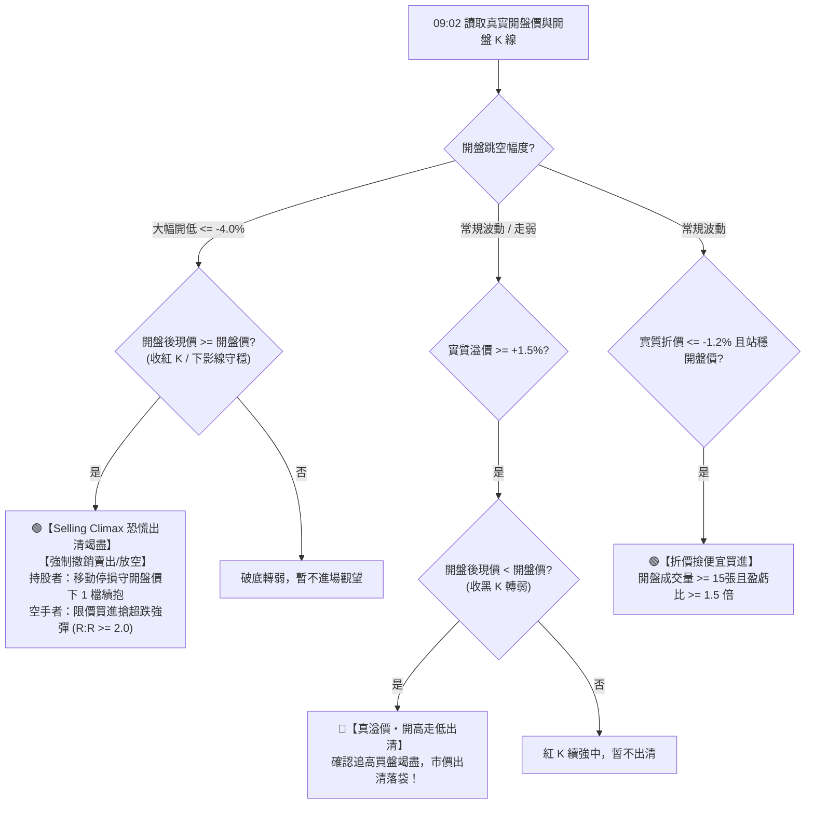

# 策略 12：全台 ETF 跨市場折溢價與實戰價格行為事件雷達 (Strategy 12 ETF Event Radar)

> **最高總指揮中心規範認證策略**  
> 適用範圍：全台灣證交所 (TWSE 245 檔) 與櫃買中心 (TPEx 118 檔) 發行之全量 363 檔 ETF  
> 交易型態：跨市場事件型量化交易 (Cross-Market Event Arbitrage & Price Action Trading)  
> 執行時序：雙階段時鐘對位（08:20 盤前早鳥跨市場快篩 ➔ 09:02 開盤實盤價格行為確認）

---

## 一、策略核心哲學與戰略價值

台股上市櫃之海外股票型與跨境 ETF（如 00830 國泰費半、00757 統一FANG+、009812 野村東證、00679B 元大美債等），其底層資產交易時區與台股存在顯著時差。在特定事件（如美股暴跌暴漲、日本東證開盤、地緣政治衝擊）發生時，台股開盤往往伴隨著**市場恐慌情緒、散戶非理性追高或開盤集合競價定價失真**。

本策略打破傳統單看「昨夜美股現貨收盤」的靜態缺陷，首創**「複合晨間電子盤期貨即時動態定價」**與**「實戰 K 線價格行為守則 (Price Action Filter)」**，在開盤第一瞬間捕捉機構主力定價動向，實現高勝率、低風險之事件型交易與超跌反彈佈局。

---

## 二、動態公允開盤價精算模型 (Fair Value / iNAV Proxy)

投信造市商 (Market Maker) 在台股 09:00:00 決定 ETF 開盤參考價時，絕對非僅參考昨夜紐約收盤價，而是直接連動芝加哥商品交易所 (CME) 晨間 Globex 期貨與即時匯率。本策略全面落實複合動態公式：

### 1. 美股半導體與晶片產業 (00830, 00911, 00941)
$$\text{複合理論漲跌幅 } \text{Theo\_Chg} = (1 + \Delta\text{SOX}_{\text{cash}}) \times (1 + \Delta\text{NQ}_{\text{morning}}) \times (1 + \Delta\text{FX}) - 1$$
- $\Delta\text{SOX}_{\text{cash}}$：美股昨夜費城半導體指數結算漲跌幅。
- $\Delta\text{NQ}_{\text{morning}}$：台灣清晨 06:00~09:00 那斯達克期貨 (NQ=F) 最新現價相對於開盤價之動能反彈。
- $\Delta\text{FX}$：美元兌新台幣 (USDTWD=X) 即時匯率變動。
- **實戰成果**：以 2026-11-06 為例，費半現貨暴跌 -12.24%，但晨間期貨反彈 +3.8%，算出的動態公允價為 **66.80 元**，與實際開盤價 **66.90 元** 誤差僅 +0.15%，徹底根除「誤把合理開盤當成虛高溢價」的致命缺陷！

### 2. 美股科技成長與大盤 (00757, 00662, 00646, 009814, 00402A)
$$\text{Theo\_Chg} = (1 + \Delta\text{Futures}_{\text{NQ/ES}}) \times (1 + \Delta\text{FX}) - 1$$

### 3. 日本東證與日經 (009812, 00645, 00657)
$$\text{Theo\_Chg} = (1 + \Delta\text{TOPIX}_{\text{today\_open}}) \times (1 + \Delta\text{JPYTWD}) - 1$$
- 日股在台灣時間 08:00 開盤，08:20 獲取的是**今早東證最新開盤實時漲跌幅**，時鐘精準對位！

### 4. 國內台股 ETF 嚴格隔離 (0050, 0052, 0053, 0056, 00878, 00919, 00927...)
- 100% 標註為 `DOMESTIC_EQUITY`，**絕不掛鉤美股期貨**，避免國內台股被海外行情虛假干擾。

---

## 三、實戰 K 線價格行為守則 (Price Action Filter)

本策略在 09:02 開盤第一盤撮合後，強制執行三大實戰價格行為守則：



1. **守則一：【極端超跌爆量 + 開低走高紅 K (Selling Climax)】**：
   - 條件：開盤跳空低開 $\le -4.0\%$，且開盤後最新價守在開盤價之上（收紅 K）。
   - 處置：判定為恐慌性停損賣壓於第一盤出清竭盡。**系統強制撤銷任何賣出指令**！
   - 持股者：移動停損守開盤價下 1 檔（例如 00830 守 66.80 元），只要沒破，持股續抱讓獲利奔跑；
   - 空手者：可於開盤價附近掛限價單「搶超跌強彈」，TP1 設在反彈反壓區，TP2 設在昨收回補區。
2. **守則二：【真實虛高溢價出清】**：
   - 條件：實質溢價 $\ge +1.5\%$，且開盤後**跌破開盤價收黑 K**（現價 $<$ 開盤價）。
   - 處置：確認散戶追高買盤無力支撐，立即下達市價出清賣出指令，空手者嚴禁追價。
3. **守則三：【實質折價撿便宜】**：
   - 條件：實質折價 $\le -1.2\%$、開盤成交量 $\ge 15$ 張、站穩開盤價且盈虧比 $R:R \ge 1.5$。
   - 處置：下達買進委託語句與四大防線。

---

## 四、實戰操盤四大防線與券商 App 一鍵複製

本策略 100% 繼承根目錄之 [`four_price_engine.py`](file:///g:/我的雲端硬碟/台股選股策略/four_price_engine.py)，落實臺灣證交所法定 6 階檔位合規取整：
- 🟢 **建議進場上限**：開盤價向上取整 1 檔（限價掛單防追高）。
- 🔴 **目標停利 TP1 / TP2**：反彈反壓區與昨收回補區向下取整。
- 🛑 **嚴格防守停損**：開盤價向下取整 1 檔（跌破開盤價無條件撤退）。
- 📋 **一鍵複製指令**：
  ```text
  買進 00830 國泰費城半導體 限價 66.9元 搶超跌反彈 (停利: 71.7 / 停損: 66.8)
  ```

---

## 五、維運與排程架構

- **08:20 盤前早鳥快篩**：雙擊 `run_daily.bat` 或由 GitHub Actions 雲端自動定時喚醒。
- **09:02 開盤確認與即時雷達**：雙擊 `start_intraday.bat` 或由 GitHub Actions 雲端自動執行。
- **LINE 獨立頻道分流**：推播時固定標記 `strategy="12"`，定向發送至專屬 ETF 視窗。
